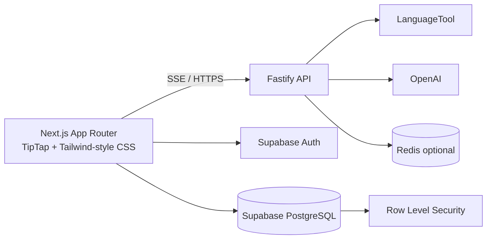

# CheckGram

CheckGram is an AI-powered writing assistant that provides real-time grammar feedback, tone-aware suggestions, sentence rewrites, and document storage. It combines a TipTap editor with a Fastify text-processing API, LanguageTool, OpenAI, Supabase Auth/PostgreSQL, and an optional Redis cache.

## Features

- TipTap rich-text editor with inline ProseMirror decorations.
- Four suggestion categories:
  - **Correctness**: spelling, grammar, and punctuation.
  - **Clarity**: wordiness and readability.
  - **Engagement**: vocabulary and expressiveness.
  - **Delivery**: tone and formality.
- 500 ms debounced analysis while writing.
- Server-Sent Events (SSE) for block-by-block analysis of long documents.
- Floating AI rewrite toolbar for selected text:
  - Rewrite
  - Shorten
  - Formal
  - Friendly
- Three generated rewrite variations with one-click replacement.
- Supabase email/password and Google OAuth authentication.
- Protected document dashboard with create, list, rename, and soft-delete actions.
- Debounced TipTap JSON and plain-text autosave.
- Row Level Security (RLS) policies for user-owned data.
- Optional Redis caching keyed by text SHA-256 and tone to reduce provider calls.

## Architecture



The browser sends the current text snapshot to the backend. LanguageTool handles deterministic grammar checks, while OpenAI handles contextual suggestions, tone analysis, and rewrites. The streaming analyzer splits long documents into blocks and emits suggestions as each block finishes. Redis is a performance optimization; the API still works when Redis is unavailable or not configured.

## Requirements

- Node.js 20 or newer.
- npm.
- A Supabase project for authentication and document persistence.
- A LanguageTool endpoint. The default public endpoint is configured for development.
- An OpenAI API key for contextual analysis and rewriting.
- Redis 7 or newer for optional caching.

## Installation

```bash
npm install
```

Create the environment files:

```bash
cp .env.example .env
cp .env.local.example .env.local
```

### Backend environment

`.env`:

```dotenv
HOST=0.0.0.0
PORT=3001
LANGUAGETOOL_URL=https://api.languagetool.org/v2/check
LANGUAGETOOL_LANGUAGE=en-US
OPENAI_API_KEY=
OPENAI_MODEL=gpt-4o-mini
REQUEST_TIMEOUT_MS=15000
REDIS_URL=redis://localhost:6379
REDIS_CACHE_TTL_SECONDS=3600
```

`OPENAI_API_KEY` is optional for grammar-only analysis, but required for OpenAI-powered categories and rewrite actions. Set `PORT=3001` when running the API beside the Next.js development server.

### Frontend environment

`.env.local`:

```dotenv
NEXT_PUBLIC_SUPABASE_URL=https://your-project.supabase.co
NEXT_PUBLIC_SUPABASE_ANON_KEY=your-anon-key
NEXT_PUBLIC_API_BASE_URL=http://localhost:3001
```

Only the Supabase URL, Supabase anonymous key, and API base URL belong in the browser environment. Never expose an OpenAI key or Redis URL through a `NEXT_PUBLIC_*` variable.

## Supabase setup

1. Enable Email provider in Supabase Auth.
2. Enable Google provider and configure the Google OAuth client credentials.
3. Add `http://localhost:3000/auth/callback` to the Supabase redirect URL allow list.
4. Add the production callback URL before deployment.
5. Apply the migrations in order:

```bash
supabase db push
```

Or run these files through the Supabase SQL editor:

```text
supabase/migrations/001_initial_schema.sql
supabase/migrations/002_documents_rls.sql
```

The migrations create documents, immutable document versions, analysis jobs, suggestions, user preferences, and suggestion events. RLS policies require ownership through `auth.uid()`. Documents are soft-deleted by setting `is_archived = true`.

More detail is available in [docs/auth-and-dashboard.md](docs/auth-and-dashboard.md).

## Redis setup

Redis is optional. To run it locally with Docker:

```bash
docker run --name checkgram-redis -p 6379:6379 redis:7-alpine
```

The cache key format is:

```text
checkgram:analysis:v1:<sha256-of-text>:<normalized-tone>
```

Cached values retain SHA-256 and MD5 fingerprints, text length, normalized suggestions, and the cache timestamp. The default TTL is one hour. Redis connection, read, and write failures are logged and treated as cache misses rather than API failures.

See [docs/redis-cache.md](docs/redis-cache.md) for implementation details.

## Running locally

Use separate terminals for the API and frontend:

```bash
# Terminal 1: Fastify API
npm run dev

# Terminal 2: Next.js frontend
npm run dev:web
```

Open [http://localhost:3000](http://localhost:3000). The API health check is available at [http://localhost:3001/health](http://localhost:3001/health) when `PORT=3001`.

If you do not need Supabase yet, the public writing workspace can still be developed without frontend credentials. Authentication and the `/dashboard` document features require valid Supabase environment variables.

## API reference

### Analyze text

```http
POST /api/v1/analyze
Content-Type: application/json

{
  "text": "This are a teh test.",
  "tone": "Professional"
}
```

Response:

```json
{
  "cached": false,
  "suggestions": [
    {
      "startOffset": 11,
      "endOffset": 14,
      "suggestionType": "Correctness",
      "replacementOptions": ["the", "ten"],
      "explanation": "Possible spelling mistake found.",
      "source": "languagetool"
    }
  ]
}
```

Offsets are zero-based JavaScript UTF-16 offsets. `startOffset` is inclusive and `endOffset` is exclusive.

### Stream analysis

```http
POST /api/v1/analyze/stream
Content-Type: application/json
Accept: text/event-stream

{
  "text": "A long document...",
  "tone": "Professional"
}
```

The SSE stream emits:

```text
event: analysis.started
data: {"blockCount":2,"textLength":2100}

event: suggestions.block
data: {"blockIndex":0,"startOffset":0,"endOffset":1200,"cached":false,"suggestions":[]}

event: analysis.completed
data: {"blockCount":2}
```

Block suggestions use offsets into the original full document. The frontend aborts an older stream when the editor changes, preventing stale results from being applied.

### Rewrite selected text

```http
POST /api/v1/rewrite
Content-Type: application/json

{
  "text": "Can you send this soon?",
  "tone": "Professional"
}
```

The response contains exactly three `{ "text": string, "explanation": string }` variations. The route returns `503` when `OPENAI_API_KEY` is not configured and `502` when the provider fails.

## Routes

| Route | Purpose |
| --- | --- |
| `/` | Public writing workspace |
| `/login` | Email/password and Google OAuth |
| `/dashboard` | Authenticated document dashboard |
| `/auth/callback` | Supabase OAuth code exchange |
| `/health` | Fastify health check |
| `POST /api/v1/analyze` | Complete text analysis |
| `POST /api/v1/analyze/stream` | SSE block-level text analysis |
| `POST /api/v1/rewrite` | Three AI rewrite variations |

## Project structure

```text
app/
  auth/callback/route.ts  Supabase OAuth callback
  dashboard/page.tsx      Protected document dashboard
  login/page.tsx           Auth UI
  page.tsx                Public editor page
components/
  dashboard.tsx            Document CRUD and autosave
  tiptap-editor.tsx        TipTap editor and rewrite toolbar
  suggestion-decoration.ts ProseMirror suggestion decorations
lib/supabase/              Browser and server Supabase clients
src/
  server.ts                Fastify routes
  analyzer.ts              Block splitting and provider orchestration
  cache.ts                 Redis cache and hash keys
  providers/                LanguageTool and OpenAI adapters
supabase/migrations/       PostgreSQL schema and RLS policies
docs/                      Detailed architecture and operations notes
```

## Validation

```bash
npm run build       # TypeScript backend build
npm run build:web   # Next.js production build
npm test            # Node test runner
```

The repository currently has no committed automated test files, so `npm test` is a test-runner entry point for future unit and integration coverage. During development, the API has been smoke-tested against LanguageTool and the SSE stream.

## Security notes

- Keep `OPENAI_API_KEY` and `REDIS_URL` server-only.
- Use Supabase RLS as the final authorization boundary; client-side filtering is not security.
- Do not send unrelated documents to external AI providers.
- Validate model-generated offsets against the exact text snapshot before displaying or applying suggestions.
- Treat provider responses as untrusted input and enforce request size limits.
