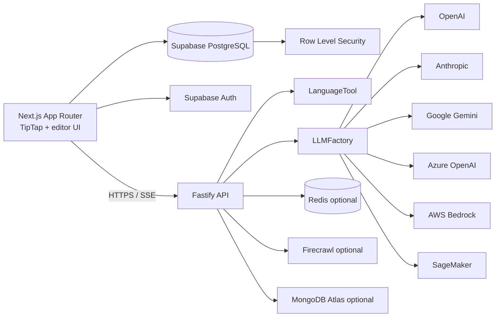

# CheckGram

CheckGram is an AI-powered writing assistant with real-time grammar feedback, tone-aware suggestions, sentence rewrites, and authenticated document storage. The application combines a Next.js/TipTap editor with a Fastify text-processing API, deterministic LanguageTool checks, pluggable AI providers, Supabase persistence, and optional Redis, Firecrawl, and MongoDB integrations.

## What is included

- TipTap rich-text editing with inline ProseMirror decorations.
- Four Grammarly-style suggestion categories:
  - **Correctness**: spelling, grammar, and punctuation.
  - **Clarity**: wordiness and readability.
  - **Engagement**: vocabulary and expressiveness.
  - **Delivery**: tone, formality, and audience fit.
- 500 ms debounced analysis while typing.
- Paragraph-level analysis with global UTF-16 offsets.
- Redis caching and cache diagnostics for repeated paragraphs.
- Server-Sent Events (SSE) for block-by-block analysis of long documents.
- Floating rewrite actions for selected text: Rewrite, Shorten, Formal, and Friendly.
- Three rewrite variations with one-click replacement.
- Supabase email/password and Google OAuth authentication.
- Protected document dashboard with create, list, rename, soft-delete, and autosave.
- Row Level Security (RLS) policies for user-owned data.
- Factory/Adapter-based AI provider switching:
  - OpenAI
  - Anthropic
  - Google Gemini
  - Azure OpenAI
  - AWS Bedrock
  - Amazon SageMaker
- Optional Firecrawl webpage context and MongoDB Atlas connectivity.

## Architecture



The API splits documents into paragraphs, computes a provider- and tone-aware SHA-256 cache key, reuses cached results when possible, and analyzes only uncached chunks in parallel. Provider adapters normalize model output into one suggestion contract. Local paragraph offsets are remapped to positions in the original document before the response is returned.

Redis is an optimization, not a requirement. Connection, read, and write failures are logged and treated as cache misses so analysis can continue without Redis.

## Requirements

- Node.js 20 or newer.
- npm.
- Supabase project for authentication and document persistence.
- LanguageTool endpoint. The public endpoint in `.env.example` is suitable for development.
- At least one configured AI provider for contextual analysis and rewriting.
- Redis 7 or newer for optional caching.
- Docker, only if you want to run Redis locally with the installation command below.

## Installation

From the repository root, install the pinned dependencies and create both environment files:

```bash
npm install
cp .env.example .env
cp .env.local.example .env.local
```

Start Redis locally before running the API if you want caching:

```bash
docker run --name checkgram-redis -p 6379:6379 -d redis:7-alpine
```

Then set at least one provider key in `.env`. For the smallest working setup, use OpenAI:

```dotenv
OPENAI_API_KEY=your-openai-key
OPENAI_MODEL=gpt-4o-mini
```

The API also supports provider-specific credentials documented in the next section. Do not put AI keys, AWS secrets, Redis URLs, MongoDB URIs, or Firecrawl keys in `.env.local` or any `NEXT_PUBLIC_*` variable.

## Configuration

### Backend `.env`

`.env.example` contains the complete list. The most important settings are:

```dotenv
HOST=0.0.0.0
PORT=3001
LANGUAGETOOL_URL=https://api.languagetool.org/v2/check
LANGUAGETOOL_LANGUAGE=en-US
OPENAI_API_KEY=
OPENAI_MODEL=gpt-4o-mini
ANTHROPIC_API_KEY=
ANTHROPIC_MODEL=claude-3-5-sonnet-latest
GOOGLE_AI_STUDIO_KEY=
GOOGLE_AI_MODEL=gemini-1.5-flash
AZURE_OPENAI_ENDPOINT=
AZURE_OPENAI_KEY=
AZURE_OPENAI_DEPLOYMENT_NAME=
AWS_REGION=us-east-1
AWS_ACCESS_KEY_ID=
AWS_SECRET_ACCESS_KEY=
AWS_BEDROCK_MODEL=
SAGEMAKER_ENDPOINT_NAME=
MONGODB_ATLAS_URI=
FIRECRAWL_API_KEY=
REDIS_URL=redis://localhost:6379
REDIS_CACHE_TTL_SECONDS=3600
REQUEST_TIMEOUT_MS=15000
```

OpenAI is used by default. Select another adapter per request with the `provider` field. `contextUrl` is optional and is scraped by Firecrawl before being passed to the analysis provider. MongoDB Atlas is an optional connector and does not replace Supabase RLS-backed document persistence unless the application is explicitly configured to use it.

### Frontend `.env.local`

```dotenv
NEXT_PUBLIC_SUPABASE_URL=https://your-project.supabase.co
NEXT_PUBLIC_SUPABASE_ANON_KEY=your-anon-key
NEXT_PUBLIC_API_BASE_URL=http://localhost:3001
```

## Supabase setup

1. Enable Email provider in Supabase Auth.
2. Enable Google provider and configure the Google OAuth client.
3. Add `http://localhost:3000/auth/callback` to the Supabase redirect URL allow list.
4. Add the production callback URL before deployment.
5. Apply the migrations:

```bash
supabase db push
```

If the Supabase CLI is not installed, run these files in the SQL editor in order:

```text
supabase/migrations/001_initial_schema.sql
supabase/migrations/002_documents_rls.sql
```

The migrations create documents, immutable document versions, analysis jobs, suggestions, user preferences, and suggestion events. Documents are soft-deleted with `is_archived = true`, and RLS policies enforce ownership through `auth.uid()`.

See [docs/auth-and-dashboard.md](docs/auth-and-dashboard.md) for OAuth, autosave, and RLS details.

## Running locally

Use separate terminals for the backend and frontend:

```bash
# Terminal 1: Fastify API
npm run dev

# Terminal 2: Next.js frontend
npm run dev:web
```

Open [http://localhost:3000](http://localhost:3000). The API health check is available at [http://localhost:3001/health](http://localhost:3001/health) when the backend `.env` uses `PORT=3001`.

## API

### Analyze text

```http
POST /api/v1/analyze
Content-Type: application/json
```

```json
{
  "text": "This are a teh test.",
  "tone": "Professional",
  "provider": "openai",
  "forceRefresh": false
}
```

The response contains normalized suggestions and chunk metadata:

```json
{
  "suggestions": [
    {
      "startOffset": 11,
      "endOffset": 14,
      "suggestionType": "Correctness",
      "replacementOptions": ["the"],
      "explanation": "Possible spelling mistake found.",
      "source": "languagetool"
    }
  ],
  "meta": {
    "totalChunks": 1,
    "cachedChunks": 0,
    "processedChunks": 1,
    "unchangedChunks": 0,
    "executionTimeMs": 142
  }
}
```

Offsets are zero-based JavaScript UTF-16 offsets. `startOffset` is inclusive and `endOffset` is exclusive. `previousChunks` may contain paragraph hashes from a prior request, and `forceRefresh` bypasses cached payloads.

### Stream analysis

```http
POST /api/v1/analyze/stream
Content-Type: application/json
Accept: text/event-stream
```

The SSE endpoint emits `analysis.started`, one or more `suggestions.block` events, and `analysis.completed`. Each block event contains offsets into the original full document, allowing the editor to render suggestions before the complete document finishes.

### Rewrite selected text

```http
POST /api/v1/rewrite
Content-Type: application/json
```

```json
{
  "text": "Can you send this soon?",
  "tone": "Professional",
  "provider": "openai"
}
```

The response contains three `{ "text": string, "explanation": string }` variations. Provider credentials are validated when the selected adapter is created, and upstream failures return a provider error rather than a fabricated success response.

## Redis cache

Cache keys include the provider, tone, scraped context, and paragraph text:

```text
checkgram:analysis:v2:<sha256>
```

This prevents a Gemini response, for example, from being reused for an OpenAI request with a different tone. The default cache TTL is 24 hours in the Redis helper; set `REDIS_CACHE_TTL_SECONDS` to change it. See [docs/redis-cache.md](docs/redis-cache.md).

## Project structure

```text
app/                         Next.js App Router pages and auth callback
components/                  TipTap editor, dashboard, toolbar, decorations
lib/supabase/                Browser and server Supabase clients
src/server.ts                Fastify REST and SSE routes
src/analyzer.ts              LanguageTool and legacy OpenAI fallback
src/services/llm/            Shared provider types, factory, parsers, adapters
src/services/integrations/   Firecrawl integration
src/db/                      Optional MongoDB Atlas adapter
src/lib/redis.ts             ioredis connection and cache helpers
src/utils/textChunker.ts     Paragraph ranges and offset remapping
supabase/migrations/         PostgreSQL schema and RLS policies
docs/                        Architecture, API, auth, and cache documentation
```

## Validation

```bash
npm run build       # TypeScript backend type-check
npm run build:web   # Next.js production build
npm test            # Chunking and provider-factory tests
git diff --check    # Whitespace validation
```

## Security notes

- Keep all provider credentials, AWS secrets, Redis URLs, MongoDB URIs, and Firecrawl keys server-only.
- Treat provider output as untrusted input and validate suggestion ranges against the exact text snapshot.
- Use Supabase RLS as the authorization boundary; client-side filtering is not security.
- Do not send unrelated documents to external providers.
- Restrict `contextUrl` usage and review scraped content before enabling it in production.
