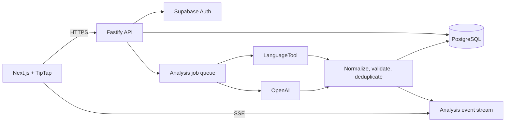

# CheckGram Architecture

CheckGram is an AI-powered writing assistant for real-time grammar checks, tone detection, and sentence rewrites.

## Technology choices

| Layer | Choice | Responsibility |
| --- | --- | --- |
| Web app | Next.js App Router, React, Tailwind CSS | Authenticated shell, editor UI, suggestion panel |
| Editor | TipTap | Structured rich text, transactions, decorations, selection-aware actions |
| API | Fastify + TypeScript | Authentication-aware HTTP API, validation, orchestration |
| Data | Supabase PostgreSQL + Auth | Users, documents, immutable versions, analysis jobs, suggestions |
| Standard analysis | LanguageTool | Fast deterministic grammar, spelling, punctuation, and style checks |
| Generative analysis | OpenAI GPT-4o-mini/GPT-4o | Tone, clarity, contextual rewrites, and audience adaptation |
| Async processing | PostgreSQL job table initially; BullMQ + Redis at scale | Durable analysis jobs and retries |
| Streaming | Server-Sent Events | Server-to-client partial analysis results |

TipTap is the default editor because its ProseMirror document model provides reliable transactions and position mapping. The service stores both TipTap JSON and a normalized plain-text projection. Suggestion offsets always refer to that plain-text projection.

## Runtime architecture



## Request and analysis flow

1. The editor debounces a change and persists a new `document_versions` row.
2. The client calls `POST /api/documents/:documentId/analyze` with the immutable version number and requested checks.
3. The API verifies document ownership, creates an `analysis_jobs` row, and returns `202 Accepted`.
4. A worker runs LanguageTool first, then invokes OpenAI only for enabled contextual checks.
5. Provider responses are normalized into the shared suggestion contract.
6. The worker validates every range against the submitted plain-text snapshot, removes conflicting overlaps, stores valid suggestions, and publishes SSE events.
7. The client applies results only when `document_version` still matches the active editor version.

Stale results must never be applied to a newer editor state. On every edit, active suggestions for older versions are treated as stale logically; they may be retained for audit history.

## API surface

```text
GET    /api/documents
POST   /api/documents
GET    /api/documents/:documentId
PATCH  /api/documents/:documentId
DELETE /api/documents/:documentId

POST   /api/documents/:documentId/analyze
GET    /api/documents/:documentId/suggestions?version=18
GET    /api/documents/:documentId/events

POST   /api/suggestions/:suggestionId/accept
POST   /api/suggestions/:suggestionId/dismiss
POST   /api/suggestions/:suggestionId/ignore

GET    /api/preferences
PATCH  /api/preferences
```

The API should use a schema validator such as Fastify TypeBox or Zod. Model output is untrusted input: reject unknown suggestion types, invalid ranges, overlong replacements, and any suggestion where `plainText.slice(start, end) !== originalText`.

## SSE event contract

```text
event: analysis.started
data: {"job_id":"...","document_id":"...","document_version":18}

event: suggestions.partial
data: {"job_id":"...","source":"languagetool","suggestions":[...]}

event: tone.updated
data: {"job_id":"...","tone":{"professional":0.84,"friendly":0.61}}

event: analysis.completed
data: {"job_id":"...","document_version":18}

event: analysis.failed
data: {"job_id":"...","message":"Analysis provider unavailable"}
```

SSE is sufficient for analysis updates because the dominant direction is server-to-client. Add WebSockets only when collaborative cursors, presence, or bidirectional document synchronization are required.

## Security and reliability

- Enforce Supabase Row-Level Security on every user-owned table.
- Use the authenticated user ID from the Supabase session; never accept an owner ID from the browser.
- Send only the selected document snapshot to external AI providers.
- Redact likely secrets before external analysis and allow users to disable AI processing.
- Apply per-user rate limits, provider timeouts, retries with backoff, and usage quotas.
- Persist provider request IDs and failure metadata without storing unnecessary prompts.
- Run deterministic checks before generative checks so common corrections are fast and inexpensive.
- Prefer a grammar correction over an overlapping rewrite; otherwise rank by confidence and severity.

## Shared suggestion contract

Offsets are zero-based, inclusive at `start`, exclusive at `end`, and encoded as JavaScript UTF-16 code-unit offsets. The backend must validate the range against the exact plain-text snapshot used for analysis.

```json
{
  "id": "sug_01J8Z5Q2V7A1",
  "document_id": "doc_01J8Z4YV6K3P",
  "document_version": 18,
  "suggestion_type": "grammar",
  "status": "active",
  "start": 10,
  "end": 14,
  "original_text": "were",
  "replacement_text": "was",
  "explanation": "Use the singular verb because the subject is singular.",
  "confidence": 0.98,
  "severity": 3,
  "source": "languagetool",
  "rule_id": "SUBJECT_VERB_AGREEMENT",
  "category": "correctness",
  "alternatives": [
    { "text": "was", "label": "Recommended", "confidence": 0.98 }
  ],
  "metadata": { "language": "en-US" },
  "created_at": "2026-10-26T12:30:45.000Z"
}
```

The machine-readable contract lives in `src/contracts/suggestion.schema.json`; the TypeScript representation is in `src/contracts/suggestion.ts`.
